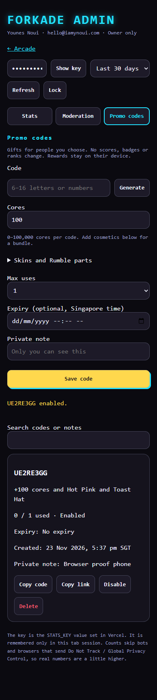
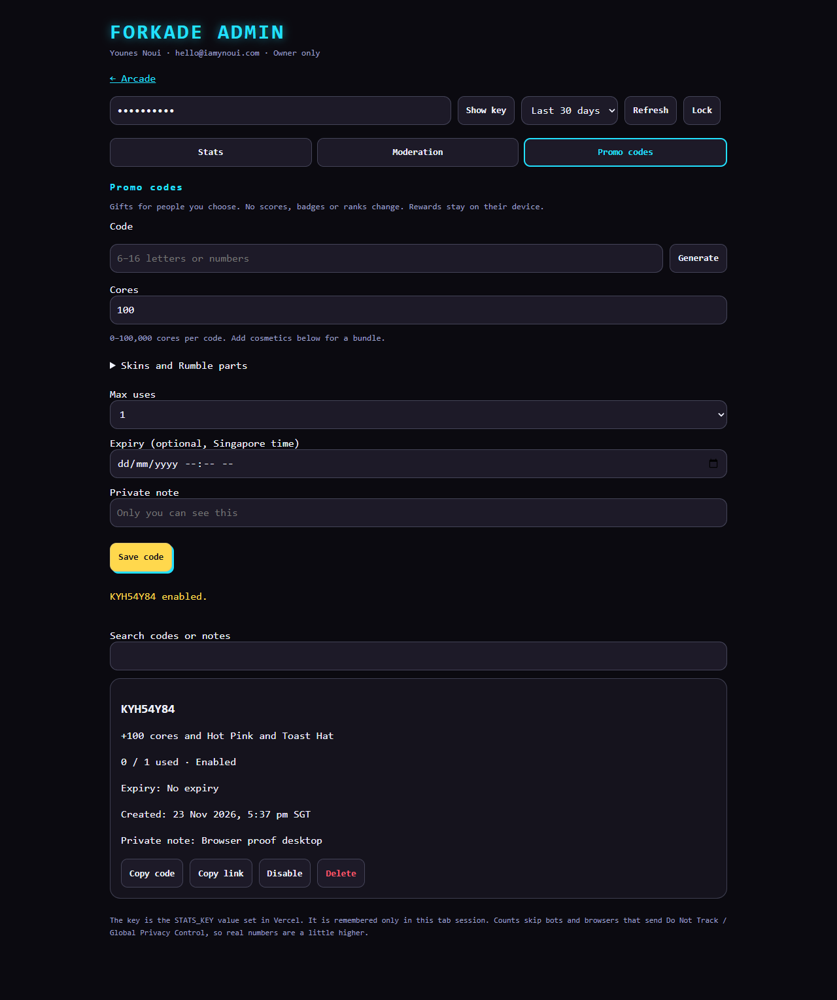
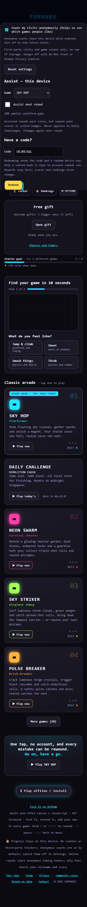
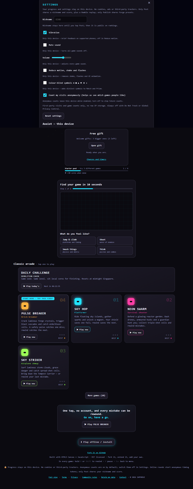

# Owner admin and local promo gifts — 23 Nov 2026

The old owner stats page now redirects to `/admin`, with Stats, Moderation and Promo codes tabs. Existing score/nickname/Forge moderation remains available. The key travels only in `X-Stats-Key`, lives only in tab sessionStorage, and Lock clears it and hides owner data.

Owners generate or choose a code, give cores/skins/Rumble parts, set real usage/expiry limits, keep a private note, search/copy/disable/delete. Players redeem only by choice in Settings; `?code=` pre-fills without submitting. All 48 Rumble parts remain free; gifts add a local collection/equip shortcut. No scores, badges, lifetime rank, streak or bonus tiers change.

## Security and storage

- Closed reward catalog; 0–100,000 cores (non-empty reward required), 6–16 alphanumeric codes, cryptographic unambiguous eight-character generator, 1/10/100/unlimited uses, max 1000 codes, 240-character private notes. All validated server-side. Expiry input explicitly uses SGT.
- One Lua operation atomically checks enabled/expiry/remaining uses/device dedupe and increments. Both keys are preview-prefixed, including every EVAL key. Per-code HMAC device hashes only; no names or raw IPs. Separate salted network hash, ten attempts/minute, fixed 60-second expiry. `PROMO_SALT` is stable and server-only; independent preview/production values.
- Local single-write receipt ledger makes retries idempotent and allows recovery after a lost HTTP response. The wallet consumes promo credits without counting them as earned lifetime. Progress is still editable local browser data, not a money or anti-cheat system. Clearing storage loses gifts/device identity, so this is a device limit, not a person limit.
- No new cookies, trackers, accounts, payments or permissions. Private notes render through textContent. Owner auth is the explicitly requested existing STATS_KEY, not a new account/2FA system. Existing score moderation reasons/history retained.
- Privacy version v9, exact Fair play disclosure, cache v52 and generated entries/offline bundle updated. The obsolete Phase-1-only privacy statement was corrected to reflect Phase 2's opt-in replay sharing.

## UX checklist (§22)

Checked trio B tokens, 44px controls, phone overflow, primary Save, progress with seven-second deadlines, reserved list space, reduced motion, 150ms press/250ms sheet curves, form defaults and optional cosmetics, empty/search states, delete confirmation (Cancel/X/Esc/backdrop), scope/consequence copy, code/key paste, show/hide key, server validation, real counts/deadlines and local reward separation. Variable-length promo codes are one field, not six-digit OTP tiles. Owner form is a compact tool rather than a customer acquisition wizard. No Me/account directory exists in this account-free arcade (approved Appendix A exception); owner name/email is displayed.

## Validation

- API suite: authorization for every owner operation, wrong keys, generated alphabet, bad payloads, enabled/expired/full/deduped codes, concurrent single-use attempts, unlimited mode, rate TTL, private response fields, per-code hashed identities, deletion/recreation and multi-key preview isolation.
- Browser: Chromium 390/1280 and WebKit 390 create → copy → disable/enable → delete → lock; Settings/query redemption, bundle cosmetics/equip, unchanged scores/badges/rank, retry after a lost response, persistence and spending. No test codes on production.
- Real Upstash Lua check: eight simultaneous redeems of a single-use code produced exactly one winner; empty-array serialization and disable enforced. Used a unique preview prefix; code, redemption hashes and rate key were cleaned.
- Deployed preview: real owner key/header authentication, create/disable/enable, bundle redemption into wallet/locker, duplicate handling and four concurrent redeems (one winner) passed; all test codes/redemption records deleted. Preview caught the social generator removing `/admin`; the generator now emits that route and the local server uses deployed rewrites rather than a test-only admin shortcut. Final `/admin` route verification follows on the corrected deployment.
- Full Chromium and WebKit web/dist matrices, existing gift/machine/bonus/Fair/UX checks, file:// offline all 2D/3D without requests, and installed v40 → v52 upgrade/deferred v53 verified.

## Platform approvals (§13)

| Connector | Scopes requested by app code | Console app/project actually used | Status | Who must click |
|---|---|---|---|---|
| Vercel | Existing hosting/functions; no user OAuth | forkade / prj_X4jPzrcRewTttJttIkROZfCvlDAj | Existing connection; server secret added | Nobody |
| Upstash | Existing REST Redis commands; no user OAuth | Existing forkade-linked Marketplace store | Existing connection; isolated preview prefix | Nobody |
| GitHub | None in runtime | YouNoui/forkade | Existing repo/PR workflow | Nobody |

No third-party app review or new connector submission is required.
