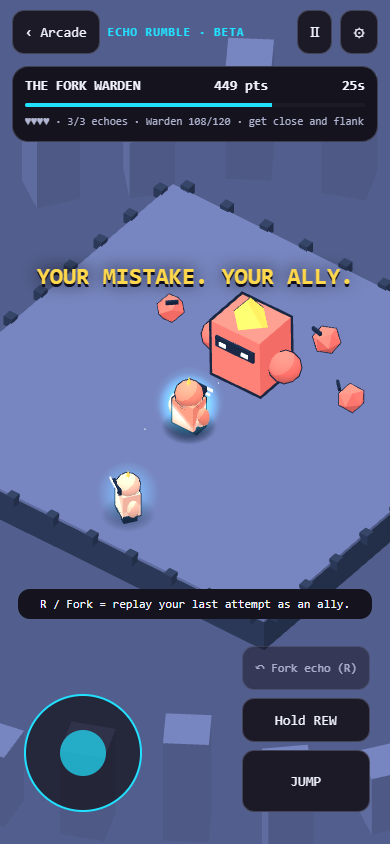
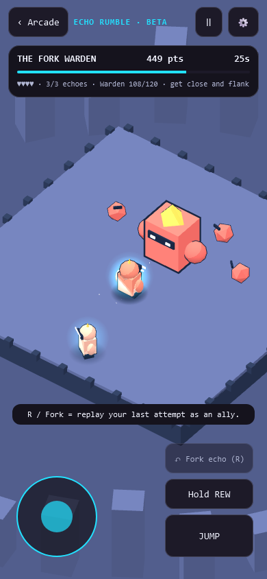
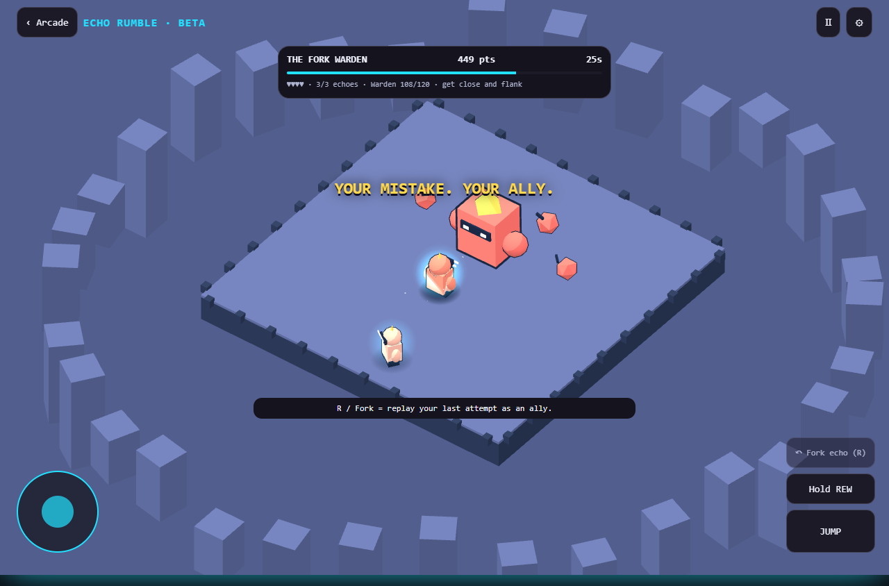

# ECHO RUMBLE — Phase 1 candidate

An original local-only 3D mutation run: seeded order of Sky Garden (climb), Candy Reactor (arena), Toy Town (smash), then the Fork Warden. The run clock is 90 active simulation seconds; hit-stop, pause and rewind can extend wall time. Defeating the boss ends it early.

Rewind a stage with **Fork echo / R**: the previous attempt becomes an input-replayed ally, up to three. Death does the same automatically. The run clock keeps moving across stage forks. Shift / Hold REW restores up to three seconds of full state. A two-echo squad breaks the boss shield. Keyboard WASD/arrows move, IJKL aims; a phone thumb stick uses auto-aim. Jump is optional because ledges auto-hop.

Twelve free choices across body, head, visor, colour, trail and victory/emote are local. Best score is local. The beta has no ranked runs, core payouts, uploaded ghosts, Forge, purchases or free-text names. Those are Phase 2 only after the owner's go. Existing thirteen games and their reward/online rules remain.

## Implementation and bounds

- Core: fixed 60 Hz, seed-separated simulation, bounded 24-world objects, 3 echoes, 20-second input replay per echo, 30 rewind snapshots at 10 Hz; snapshot includes RNG, targets, squad, logs, score and combo.
- Renderer: unchanged licensed offline THREE r128, original low-poly geometry, toon materials/outlines, soft local contact shadows, additive glow/shot pool (24), 96 pooled particles, instanced skyline/studs; DPR capped at 2. No fetched art, sound, fonts or code.
- Sound: procedural stage keys and mutation drops through Forkade's existing master gain. Reduce motion disables shake, hue transition, slow effects and trails; vibration honors the existing toggle.
- Privacy: no new API/storage/backend. Avatar/best localStorage keys use `forkade-`; in-memory replays leave the device only in the owner's separately captured video. Delete my data clears saved avatar/best.

## Verification

- `npm test`: simulation replay, echo replay, automatic death forks / three-echo cap, snapshot rewind, boss victory, Singapore midnight seed, input bounds; existing API/privacy tests retained.
- `npm run test:browser`: Chromium and WebKit, web/dist × 1280×900, 390×844, 844×390. Existing games, settings, navigation, legal/share, tokens and deterministic Daily passed.
- Existing growth, assist, bonus, experiment, fair, ux, social-browser and game-upgrades suites passed. Offline file:// 2D + all three 3D games passed in Chromium and WebKit with zero network/errors.
- `tests/rumble-browser.cjs`: Android UA 390, iPhone UA WebKit 390, desktop 1280, landscape 844, offline dist in both browsers; saved avatars, actual touch rewind, squad fork, pause, settings pause, back, no beta submissions, deterministic restore and 30-second scripted simulation.
- Real-time scripted input run won with 2,432 points, 18× combo, four forks; no time skips. Video has four real-time excerpts plus the actual captured master audio, 40.00 seconds, H.264/AAC, 390×844. Three PNGs extracted from it. Artifacts: `C:\Users\Younes\Desktop\shared process\echo-rumble\phase1.mp4`.
- CPU simulation + render submission results are in metrics.json. These are not GPU or physical-phone FPS. Dedicated 390×844 DPR2 SwiftShader sampling measured ~56.8 ms mean frame interval (~17.6 FPS); DPR1 measured ~20.4 ms (~49 FPS); software rendering does not establish the requested 60 FPS on a mid-range Android phone. Physical Android FPS, haptics and speaker quality remain unverified.
- Windows WebKit uses reduced motion for navigation because its native Back + ViewTransition path crashes the test runner; Chromium covers animated navigation.

## Release progression

Pulse Breaker #29 is merged at 55bf860 with green checks. Initial Vercel API/CLI deployment attempts hit the 100/day quota, but the Git-integrated ECHO RUMBLE preview subsequently reached READY at 731cbfd. The final follow-up commit again hit the Vercel daily deployment limit. The remaining per-game polish queue is stopped.

Protected preview 731cbfd passed Android/iPhone 390, desktop1280, landscape844 and offline parity; exact Vercel-injected toolbar CSP warnings were reported separately (no application errors). Production was opened at 390 and 1280: no Rumble hero and no polished Breaker yet.

PR #30 contains this phase. Merge only the reviewed green head; watch the production deployment and verify Android/iPhone 390 and desktop1280 on playforkade.com. GitHub code CI passed on 859f662, but its Vercel check is rate-limited, so the PR remains open and production still serves the preceding release. Production results must be recorded in the PR body and shared checkpoint after release. No billing changes were made.

The CLI `env run` preview-test attempt unexpectedly created a separate test-only `rumble-browser` project. Its source tree was inspected: exactly one file, src/rumble-browser.cjs, no secrets. The project was paused immediately. Preview tests now use a short-lived Vercel share link, scoped to the intended Forkade deployment; it is never committed. The old preview also injects a Vercel toolbar blocked by the strict CSP: preview tests report those exact host-only warnings separately, while still failing all application errors. Preview and production toolbar injection is now disabled in project settings for future deployments. The user must explicitly authorize deletion of that paused accidental project because their guardrails prohibit deleting production projects/domains.

## UX checklist (§22)

Checked 1–12 and 15–17: trio-B shell; separate game palettes; 44px controls; 390/1280 and landscape; instant local feedback; fixed canvas/loading layout; reduce motion; presets instead of text; closable focus-trapped avatar sheet (X/Esc/backdrop/swipe); reset-by-retry/local data deletion; saved scope; real score/combo/clock and no marketing countdowns. §3.1 radii/alpha borders/dvh and §5.1 pressed state respected. No auth/code/password flow (§6), accounts/Me/admin or third-party submission (§13) in this phase. §22.18 production verification follows the green merge; the final outcome is in the PR body.

| Connector | Scopes requested by this change | Console app ID | Status | Who must click |
|---|---|---|---|---|
| None | None | None | No third-party submission | Nobody |

## Needs Younes

- Show the video to your son: **keep going / change X**.
- Vercel deployment quota reset (or an owner-approved plan change) is required before the final commit can deploy, merge green and go live.
- Explicit cleanup approval for the paused accidental test-only project (no secrets/data). No payment or billing change was made.
- A real mid-range Android phone is needed to verify 60 FPS and haptics; headless emulation cannot certify that target.
