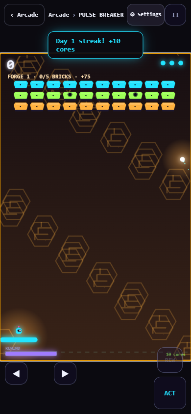
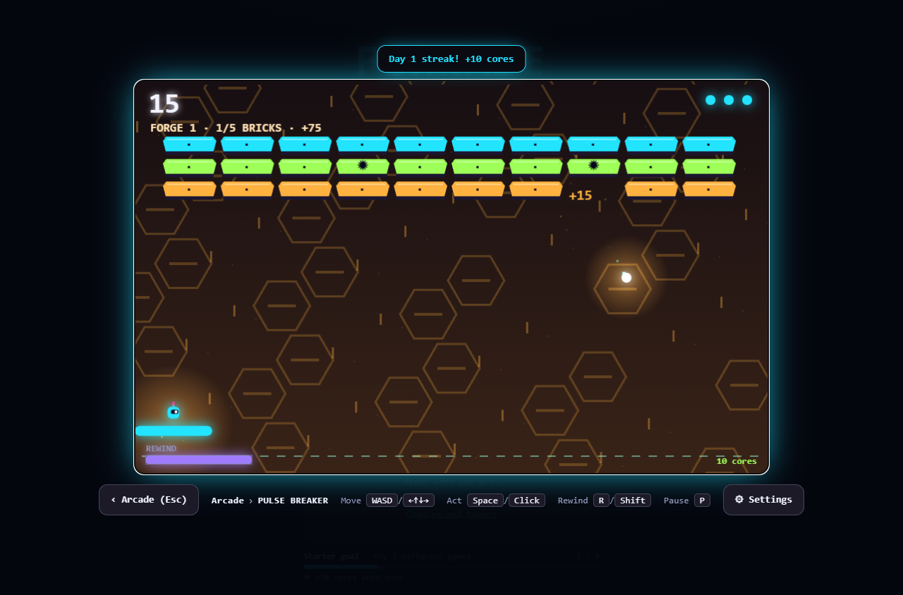

# Pulse Breaker — crystal forge

Bevelled crystal walls, readable durability pips and blast/core symbols replace flat blocks. Three cached forge layers, light pools, a pulse trail and shared music/feedback give hits weight. First wall is shorter; one safety pulse catches the first miss. Blast crystals cascade through nearby bricks. Five destroyed bricks pay +75; timed cells offer 12s of wide paddle or 8s of piercing blaze. Every two minutes a remaining crystal becomes a five-hit reactor core worth +500 and a refreshed safety pulse.

One-thumb drag/tap controls and portrait layout remain. The end screen reports actual bricks/walls/combo and distance to the local best, with the shared prominent Play again action. All power timers, pickup state, safety pulse, paddle width, click edge and reactor deadline rewind. Wall-clear cores retain once-per-round keys.

Proof: 1,800 scripted steps (30 simulated seconds), identical seed replay, approximately three seconds of rewind, reactor spawn and power restoration pass. CPU render timing 0.242ms → 0.213ms; full-frame sample ~0.553ms on this PC. Source 6.47 → 10.48 KiB. CPU submission timings are not physical Android/GPU frame-rate guarantees. Shared particles cap at 240 and falling cells at six.

Badge tiers 1500/5000/12000; score cap raised from 2M to 3M for cascading bonus-rich runs. Existing 3000 points/second screen remains, old rankings untouched. Fair play reads badge tiers from the runtime.

API tests and local Android390, WebKit/iPhone390, desktop1280 checks pass. Full web/dist browser matrices and offline checks run before merge; Windows WebKit navigation uses the documented reduced-motion fallback. No physical-device haptics/audio/A2HS claim.

UX §22: existing 44px controls, portrait readability, real goals/timers, local settings, reduced motion and one-tap replay; no new forms, dialogs or third-party submissions. §3.1 original arcade palette/depth (Appendix A), §5.1 existing UI preserved, §6 auth not applicable.

Before/after clip: `C:\Users\Younes\Desktop\shared process\forkade-games-before-after\breaker.gif` (about 12s, capture timing preserved).
