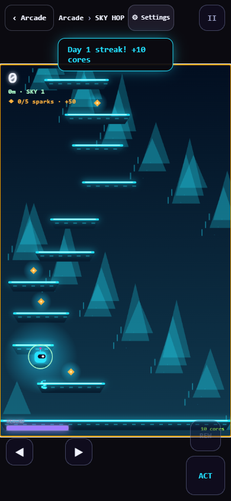
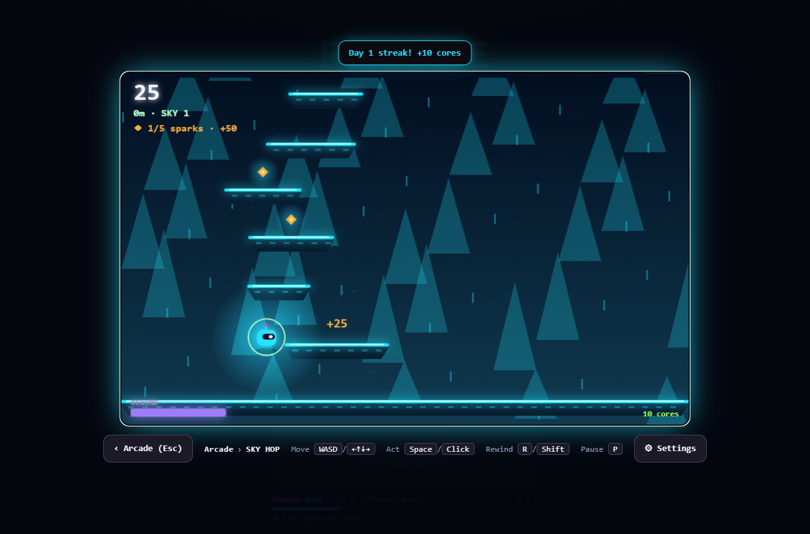

# Sky Hop — sky islands

Original procedural art: three cached depth layers, light pools, floating platforms, animated ECHO, shaped sparks and landing debris. Hold Jump and steer; moving islands arrive at 35 seconds, crumbling islands at 70. One shield rescues a fall; five sparks pay +50 and an eight-second magnet. Later spark milestones restore the shield. Real height/sparks/combo/best are shown after the run.

Shared opt-in engine helpers add a bounded particle pool, hit stop, slow motion, popups, pitched combo feedback and procedural music; only Sky Hop opts in. Vibration has a persisted on-by-default toggle and is suppressed by Reduce motion. Music uses the master gain and pauses with gameplay. No new network services, data collection or submissions.

Validation: 1,800 scripted fixed steps (30 simulated seconds); identical seeded replay; 179 history pops (approximately 3 seconds) restore the expected snapshot including new gameplay/juice state; reduced-motion checks; average 120 full headless frames 0.45ms. Render-only baseline 0.09ms, after 0.37ms on this desktop; this is CPU command-submission timing, not GPU or real Android frame rate. Source 5.18 → 9.20 KiB. Rewind snapshots necessarily allocate; cosmetic particles are pooled/capped at 240 and worlds are prerendered once per reset.

API tests, Chromium web/dist at 1280/390/844, Assist/bonus/Fair tests and offline Chromium/WebKit pass. Local Android390, WebKit/iPhone390 and desktop1280 pass. Screenshots below. The all-game WebKit matrix also runs before merge. Badge goals changed to 200/650/1500; the existing 150 points/second bound and score cap remain generous for +50 per five sparks, with old rankings untouched.

UX §22: checked readable phone layout, existing 44px controls, truthful scores, reduced motion, instant input, local settings scope, no new dialogs/auth, original game palette (approved Appendix A exception). §3.1 procedural canvas uses existing arcade glyphs and depth; §5.1 non-game UI preserved; §6 account forms not applicable.

12-second before/after GIF: `C:\Users\Younes\Desktop\shared process\forkade-games-before-after\skyhop.gif`. Haptics/audio on physical iPhone and real-phone frame time remain unverified.
